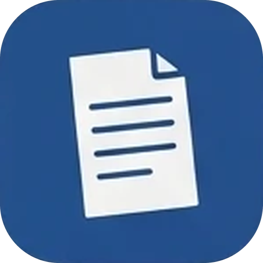
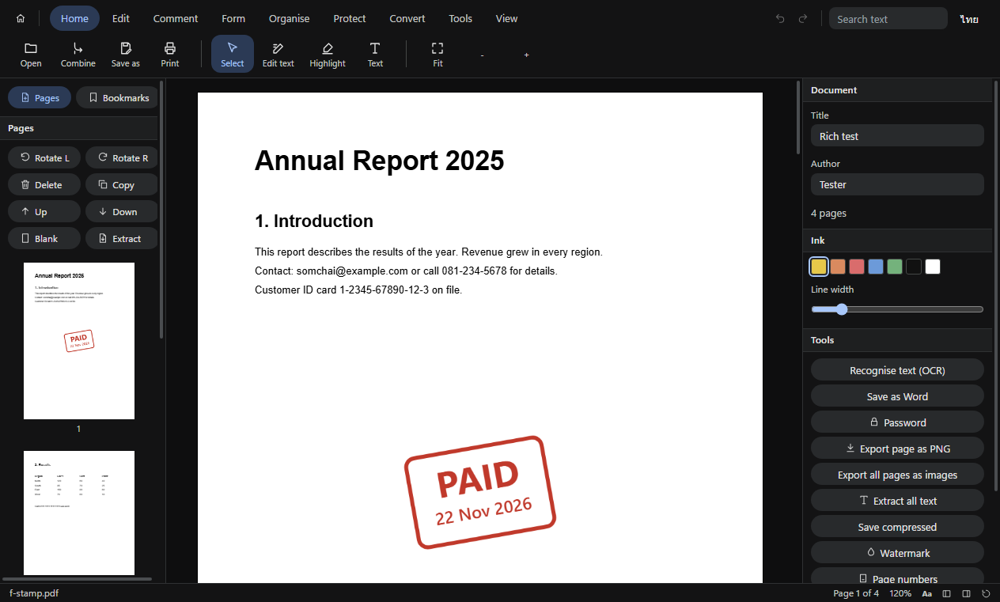
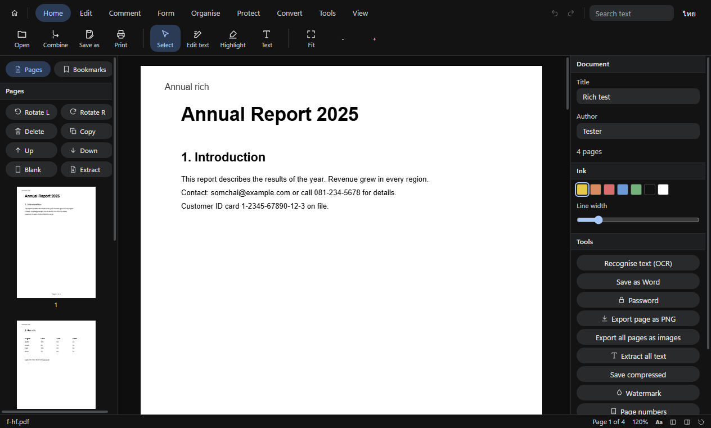
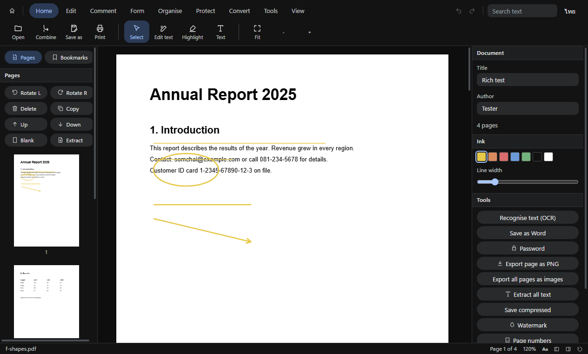
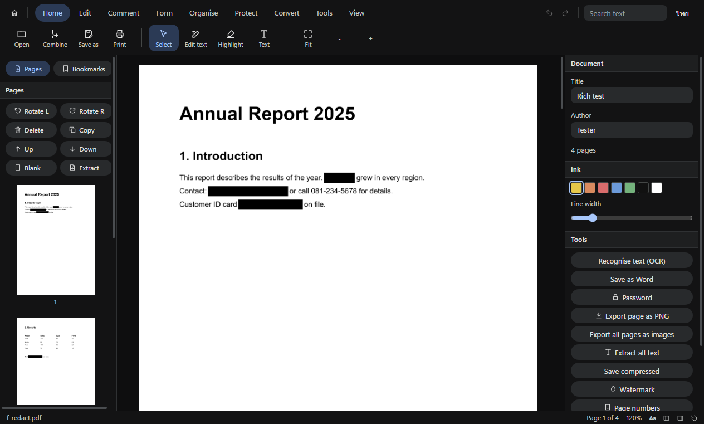
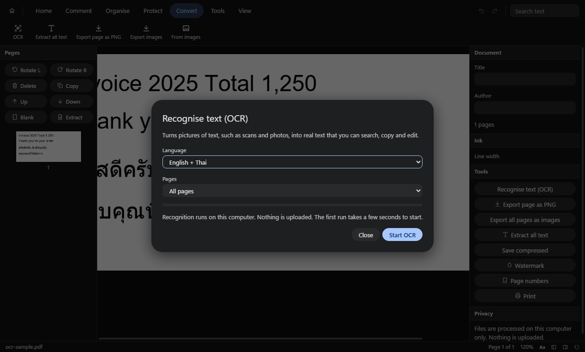
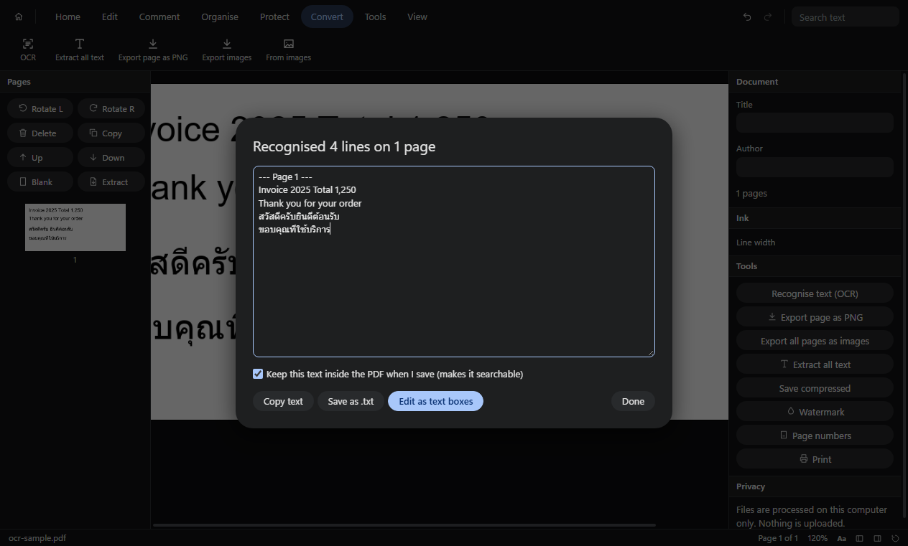

<h1 align="center">PDFout</h1>

<b>The PDF desk that never leaves your computer</b> Version 1.0.24 (beta) for Windows · Free · Offline · No account

<a href="https://github.com/plawanpawin-byte/pdfout/releases/tag/v1.0.24"><b>Download the beta</b></a> · <a href="https://github.com/plawanpawin-byte/lookout-launcher">Lookout launcher</a> · <a href="https://github.com/plawanpawin-byte/Lookout">All Lookout apps</a>

---

> **Beta notice.** Version 1.0.24 is a public beta. It contains everything described below and has been tested by driving the real application, but it has not had the long soak of a stable release. If something misbehaves, your original files are never touched, because PDFout always saves to a new file.

## What is new in 1.0.24

- New Google-style look (rounded panels, floating ribbon, Material icons), also in Thai.
- Closing the window or opening another file now asks first when you have unsaved work, and a failed open never loses the open document.
- Saves are safe: written to a temp file then renamed, with a plain message if the file is read-only or locked.
- Form fields: values show, count as changes, survive Save as and Flatten (Thai too); a password set for one file no longer locks the next.
- Redaction no longer leaves unused copies of the redacted page in the saved file.
- F6 moves between the main areas of the window; Fit page fits above the ribbon.
- Known gaps: form edits are not undo steps, copied form pages share field names, files opened with "Open with" are not yet registered by the installer.

## The story in one minute

Every office has the same small rituals. A contract arrives by email and has to be signed. A report needs three pages removed and a phone number hidden before it goes to a client. A scan from the school office has to be turned into text. A pile of invoices has to become one file.

For years those jobs meant one of three bad choices: pay a monthly subscription for a big PDF suite, upload private documents to a free website you know nothing about, or squint at a clumsy tool from 2008.

PDFout is the fourth choice. It is a full PDF workshop that installs like any ordinary program, runs with the network switched off, asks for no account, and keeps every byte of your document on your own disk. Open a file, do the job, save a new copy, close the window. That is the whole relationship.

## A tour of the workshop

### The home screen

When PDFout opens, you land on a calm start screen: your recent files on one side, a star list for the documents you return to often, and a row of **quick tools** on the other. There are many tools, so they are grouped into categories (Popular, Write and fill, Pages, Protect, Convert, Tools, All) and you see a handful at a time instead of a wall of buttons.

### Reading

Documents open in a continuous view with live thumbnails on the left and document details on the right. You can zoom with the wheel, fit the page to the window, fit the whole page, switch to dark pages for night reading, go full screen, and search every word in the file with each match highlighted. A bookmarks panel shows the document's outline, and a read-aloud button speaks the page using the voices installed in Windows.

### Marking up

The Comment tab holds the tools you would use with a pen and a highlighter: highlight, underline, strikeout, text notes, boxes, ellipses, lines, arrows and a freehand pen, in seven ink colours with adjustable thickness. Every mark can be selected, moved, resized, erased or undone, and undo works for every change you make, including page operations.

### Writing on the page

A PDF is normally a finished object. PDFout lets you write on it anyway.

- **Edit text** turns every line of real text into a clickable target. Click a line, change the words, press OK. PDFout covers the old line with a patch that matches the page colour and writes the new words on top, at the same size and colour.
- **Replace text** changes every occurrence of a word or phrase across the whole document in one go.
- **Stamps** such as Approved, Paid, Draft and Confidential, plus tick, cross and date marks.
- **Pictures**, **links** (to a web address or to another page), **header and footer**, **page numbers** and **Bates numbers** for legal work.

*A stamp with the date, placed on the first page and saved by PDFout, then reopened in the viewer.*

*A running header at the top of the page and a page number at the foot (visible in the thumbnail), added to all pages in one step.*

*Ellipses, lines and arrows drawn on the page and saved into the file.*

### Filling and building forms

Open the Form tab and draw **text fields, checkboxes and dropdown lists** anywhere on a page. When you save, they are genuine fill-in fields that work in any PDF reader. You can also open FDF or XFDF form-data files and pour their values into a form.

### Signing

There are two kinds of signature, and PDFout does both.

**A drawn signature** is what most people mean: draw it once with a mouse, pen or touch screen, drop it on the line, resize it to fit.

**A digital signature** is a cryptographic seal. You create a signing identity inside PDFout, or bring your own certificate file (.pfx or .p12), and the saved PDF carries a real PKCS#7 signature that PDF readers can verify. The **Check signatures** tool opens any signed file and tells you who signed it and whether a single byte has changed since.

*Self-signed identities show as "unverified" in other programs, because no public authority vouches for them. The seal still proves the file has not been altered after signing.*

### Redaction that is really redaction

Drawing a black rectangle over text hides it from the eye but not from a copy and paste. PDFout's redaction is different: when you save, the covered area is turned into solid pixels and the text underneath no longer exists in the file.

You can redact by dragging a box, by typing **words**, or by choosing **personal-detail patterns**: email addresses, phone numbers, Thai national ID numbers and bank card numbers are found and blacked out across every page.

*The result: the email address, the phone number and the ID number are gone for good. Only the unaffected text remains selectable.*

PDFout also warns you when something it cannot check is still there, such as sideways text or private details sitting in bookmarks or document properties, and **Clean metadata** removes the hidden author, dates and producer.

### Organising pages

Select pages in the thumbnail strip and rotate, delete, copy, move, insert a blank page or extract them into a new file. Or drag the thumbnails to reorder them directly. Beyond that:

- **Crop** margins, or trim white edges automatically.
- **Paper size**: scale pages to A4, Letter and other sizes.
- **Insert pages** from another PDF or a picture, **split** a document into several files, **reverse** the order, select **odd or even** pages, and find and delete **blank pages**.
- **Bookmarks**: add, rename and rearrange them, let PDFout find headings for you, and generate a clickable **contents page**.

### Comparing and searching across files

**Compare** shows which words changed between two versions of a document, page by page, or draws the pages with the differences in red. **Find in files** searches an entire folder of PDFs for a word; click a result to jump to that page.

### Scans and OCR

A scan is only a picture of text, so you cannot search or copy it. The built-in OCR engine reads the picture, in English, Thai or both, entirely offline. You can copy the text, save it as a .txt file, or choose **Edit as text boxes**, which covers each recognised line with a patch and puts the same words on top as editable text. Leave **Keep this text inside the PDF** ticked and the saved file becomes searchable.

### Converting

- **Word (.docx)** with tables and pictures, **Markdown**, a **web page**, **tables as CSV** for a spreadsheet, and **every embedded picture** saved as a file.
- **PDF/A** archive copy for long-term keeping. The output was checked with the veraPDF validator.
- **Grey copy** to save ink and **clean copy** to tidy a scan.
- **Images to PDF** and **every page to pictures**.
- **Batch**: run one job (join, shrink, lock, unlock, clean metadata, rotate, pages to pictures, pictures to PDFs) over many files at once, writing the results into a folder you choose.

### Passwords

Lock a PDF with a password and decide whether people may print, copy or edit it. The file is saved with strong 256-bit encryption created on your own computer. Open a locked file by typing its password; a wrong password simply asks again. If you forget it, nobody can recover the file, so keep it safe.

### Language

The whole interface can be switched between English and Thai with the button at the top right. Text boxes and OCR support Thai script, and Thai text is embedded correctly when you save.

## Private by design

PDFout was built around a simple promise: **your documents never leave your computer.**

- No account, no sign-in, no subscription, no ads, no tracking.
- The app works with the network disconnected, and its window is configured so it cannot make network requests at all.
- Files are opened and saved only through the Windows file dialogs you use. PDFout cannot browse your disk by itself.
- The program runs in a locked-down sandbox with a strict content policy.
- The OCR engine, the fonts and the language data are packed inside the installer, so nothing is downloaded when you use them.

## How a typical job goes

**Signing a contract.** Open the file, choose Sign, draw your signature, place it on the line, press Save as. Send the new copy. The original stays as it was.

**Sending a report safely.** Open it, run Protect > Redact patterns to black out emails, phones and ID numbers, delete the two pages that are internal, run Clean metadata, then Save as. Check the result in the viewer before you email it.

**Turning a scan into text.** Open the scan, choose Convert > OCR, pick the language, start. Copy the text, or save the searchable PDF.

**Tidying a pile of invoices.** Tools > Batch, choose the PDFs, choose Join, pick a folder. One file comes out.

## Keyboard shortcuts

| Keys | What it does |
| --- | --- |
| Ctrl + O | Open a PDF |
| Ctrl + S | Save |
| Ctrl + Z / Ctrl + Y | Undo / redo |
| Ctrl + mouse wheel | Zoom the page |
| Ctrl + plus / minus | Zoom in / out |
| Delete | Remove the selected mark |
| Ctrl + F | Search the text |
| Ctrl + P | Print |
| Page Up / Page Down | Previous or next page |
| Home / End | First or last page |
| F11 | Full screen |

## Files and formats

Opens PDF files (including ones locked with a password, if you know it), pictures (PNG, JPG, WebP, BMP, GIF) and FDF / XFDF form data. Saves PDF, with an optional password or digital signature, and PDF/A archive copies. Exports pages as PNG, the document text as plain text, Word (.docx), Markdown, HTML and CSV tables. OFD files are not supported.

## Honest limits

- PDFout changes text one line at a time. It does not reflow whole paragraphs, so it is not a word processor, and new text uses a standard font rather than the original one.
- By default, **Edit text** leaves the old words hidden under the patch. For secrets, tick **Remove the original text permanently** or use Redact.
- **Crop** hides the trimmed area but does not delete it from the file. Use Redact for private content.
- OCR works best on clear, straight, high-contrast pages. Handwriting and blurry photos are often wrong, and Thai is read less accurately than English.
- Pages you redact are saved as pictures, so their text can no longer be selected.
- Self-signed digital signatures show as unverified in other programs.
- Very large files can use a lot of memory when split, batched or saved with many images.

## Install

1. Open the [v1.0.24 release](https://github.com/plawanpawin-byte/pdfout/releases/tag/v1.0.24) and download **PDFout-Setup-1.0.24.exe**. You can also install it from the [Lookout launcher](https://github.com/plawanpawin-byte/lookout-launcher).
2. Run the installer. It installs just for you, so it does not need administrator rights.
3. Windows may show a blue **Windows protected your PC** screen because the installer is not signed with a paid certificate. Click **More info**, then **Run anyway**.
4. Open PDFout from the Start menu.

**Requirements:** Windows 10 or 11, 64-bit, about 500 MB of free disk space. No internet connection is needed to use the app.

## Questions

**Does redaction really remove the text?**
Yes. When you save, redacted areas become solid pixels in the new file, so the text underneath no longer exists there.

**Will it change my original PDF?**
No. PDFout writes a new file. Your original is never overwritten unless you choose the same name yourself.

**Can it open password-protected PDFs?**
Yes, if you know the password. It can also add a password to any PDF.

**Is my signature stored somewhere?**
Only inside the files you sign and on your own computer. Nothing is sent anywhere.

**Does OCR need the internet or an account?**
No. The engine and the English and Thai language data are inside the app.

**Why is the installer large?**
It carries a complete PDF engine, the OCR engine with two languages, and fonts, so that nothing has to be downloaded later. That is about 140 MB.

## About Lookout

PDFout is part of **[Lookout](https://github.com/plawanpawin-byte/Lookout)**: ten small, private Windows apps for documents and media that share one look and one promise, that your files stay on your computer. Install and update them together with the [Lookout launcher](https://github.com/plawanpawin-byte/lookout-launcher).

| | App | What it is for | Code |
| --- | --- | --- | --- |
|  | **Lookout** | Install, open and update all the apps below | [GitHub](https://github.com/plawanpawin-byte/lookout-launcher) |
|  | **PDFout** | Read, annotate and sign PDFs | [GitHub](https://github.com/plawanpawin-byte/pdfout) |
|  | **Chartout** | Flowcharts, org charts and diagrams | [GitHub](https://github.com/plawanpawin-byte/chartout) |
|  | **Branchout** | Mind maps and outlines | [GitHub](https://github.com/plawanpawin-byte/branchout) |
|  | **Planout** | Project plans and Gantt timelines | [GitHub](https://github.com/plawanpawin-byte/planout) |
|  | **Frameout** | App and web screen design with click-through prototypes | [GitHub](https://github.com/plawanpawin-byte/frameout) |
|  | **Cutout** | Video editing on a timeline | [GitHub](https://github.com/plawanpawin-byte/cutout) |
|  | **Shiftout** | Convert and compress video and audio, make GIFs | [GitHub](https://github.com/plawanpawin-byte/shiftout) |
|  | **Castout** | Record your screen | [GitHub](https://github.com/plawanpawin-byte/castout) |
|  | **Mendout** | Check and repair damaged video, audio, pictures and PDFs | [GitHub](https://github.com/plawanpawin-byte/mendout) |
|  | **Tuneout** | Record and edit audio | [GitHub](https://github.com/plawanpawin-byte/tuneout) |

Released under the MIT License.
