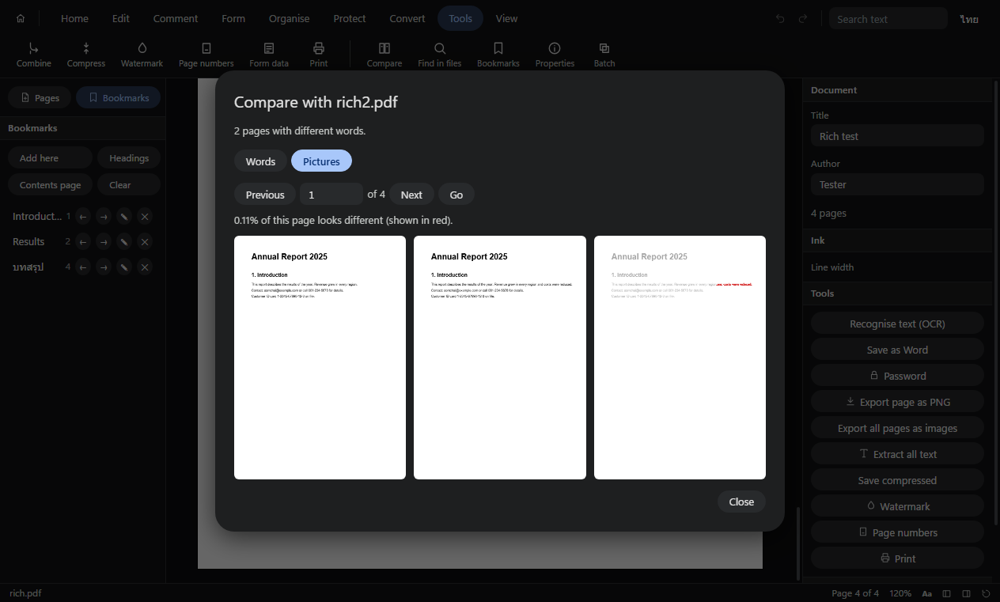
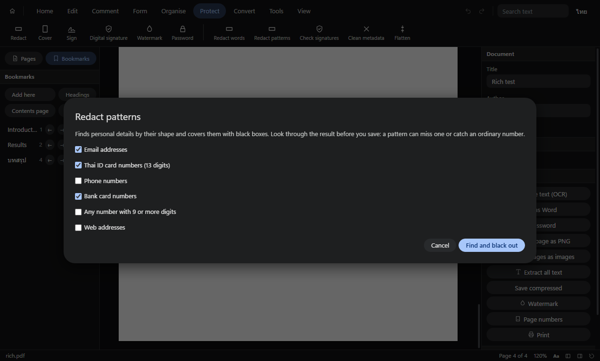
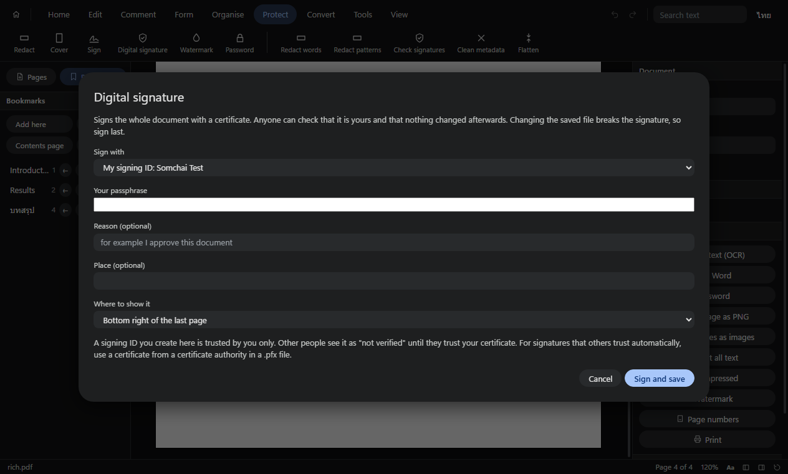
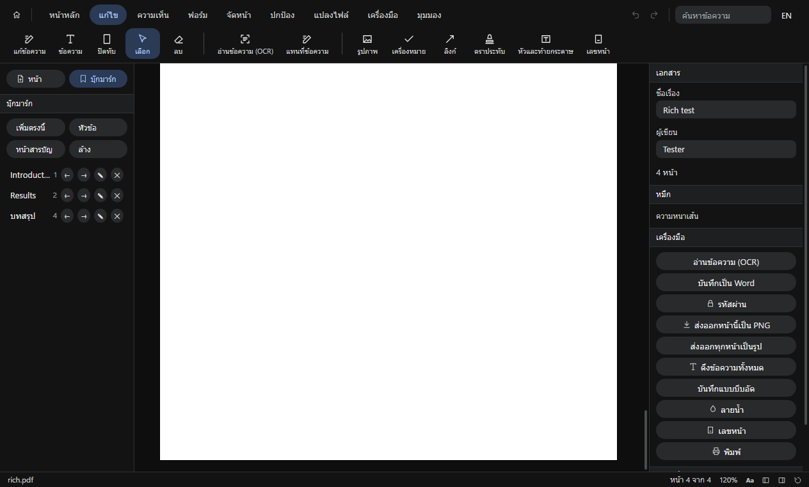
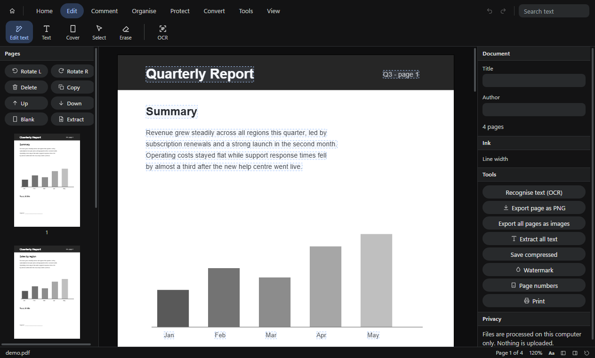
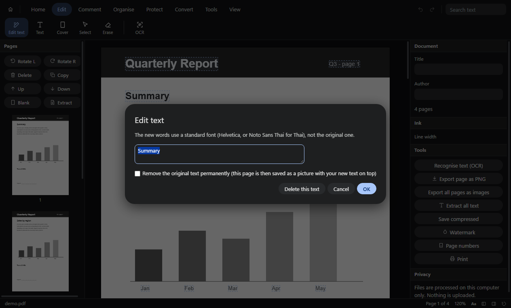
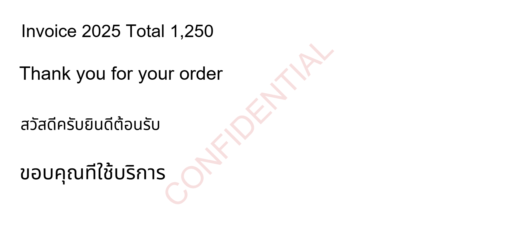
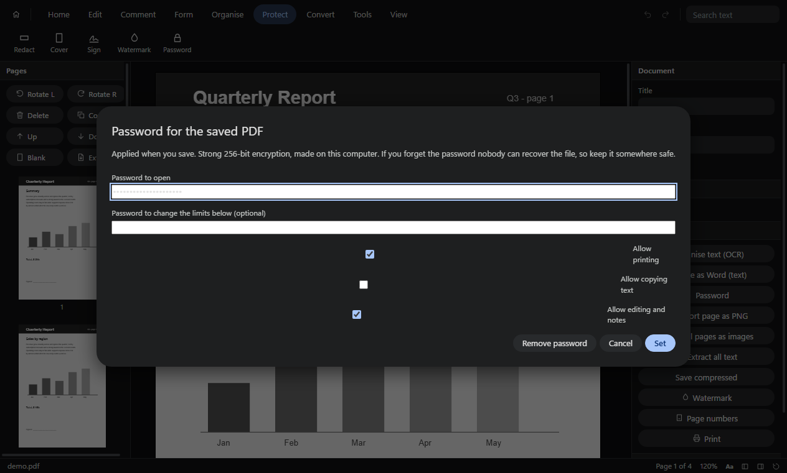

<h1 align="center">PDFout</h1>

<b>Read, annotate and sign PDFs</b> Version 1.0.21 for Windows · Free · Offline · No account

<a href="https://github.com/plawanpawin-byte/pdfout/releases/latest"><b>Download PDFout</b></a> · <a href="https://github.com/plawanpawin-byte/lookout-launcher">Lookout launcher</a> · <a href="https://github.com/plawanpawin-byte/Lookout">All Lookout apps</a>

---

PDFout is a PDF reader and editor for Windows that works entirely on your computer. Open a document, highlight what matters, write notes, draw, sign, black out private details, rearrange pages and save a new copy. There is no account to create, no subscription and nothing is uploaded.

**Made for:** People who handle PDFs every day: contracts to sign, reports to mark up, scans to tidy, documents to share without leaking private details.

**On this page:** [In plain words](#in-plain-words) · [Who it is for](#who-it-is-for) · [Try it in 3 steps](#try-it-in-3-steps) · [Screenshots](#see-it-in-action) · [Edit text](#edit-the-text-that-is-already-in-a-pdf) · [OCR](#text-recognition-ocr-editing-text-that-is-a-picture) · [Features](#everything-it-can-do) · [How to use it](#how-to-use-it) · [Privacy](#private-by-design) · [Install](#install) · [Questions](#questions)

## In plain words

PDFout (called Pageout in earlier versions) is a program for working with **PDF files** (the kind of document you get from a bank, a school, a government office or a contract). It does what you would do with a pen and a printer, but on screen: you read the document, highlight sentences, write notes in the margin, draw or sign with the mouse, and then save the result as a **new PDF** that you can email.

It can also tidy a document. You can rotate a sideways page, delete a page you do not need, move pages up or down, add a blank page, or pull a few pages out into their own file. It can **black out** private details such as an ID number so that the text is really removed from the file, not just covered.

**Good to know:** PDFout changes text one line at a time and does not re-flow whole paragraphs, so it is not a word processor. Text recognition (OCR) works for English and Thai pictures and scans. It does not open OFD files, and it does not turn a PDF into Excel or PowerPoint (it can save tables as CSV for a spreadsheet). The whole program can be switched between English and Thai with the button at the top right.

## Who it is for

- **Students and teachers** who highlight and take notes on papers and worksheets.
- **Anyone who signs documents**: draw your signature once, place it on a form, save the signed copy.
- **Office workers** who need to remove a page, rotate a scan or hide a phone number before sending a PDF to someone.

## Try it in 3 steps

1. Click **Open**, choose any PDF, and scroll through it. Use the page list on the left to jump around.
2. Pick the highlighter in the top bar, drag over a sentence, then press **Save** to keep a copy with the highlight in it.
3. Choose **Export page as PNG** in the right panel to turn the current page into a picture.

## What is new in 1.0.21

**Important fix:** in 1.0.20, saving a PDF that contained Thai text failed with an error. That is fixed. If you installed 1.0.20, please update.

**Start screen in categories.** The quick tools are now grouped (Popular, Write and fill, Pages, Protect, Convert, Tools), so the start screen shows a few at a time instead of one long list.

**Thai interface.** Press the **ไทย / EN** button at the top right to switch every menu, button and message between Thai and English. PDFout starts in Thai on a Thai Windows.

**Organise more.** **Crop** the margins (or trim white edges automatically), change the **paper size** (A4, Letter and more), **insert pages** from another PDF or picture, **split** a document into several files, reverse the order, select odd or even pages, find and delete empty pages, and **drag thumbnails** to reorder pages.

**Bookmarks and contents.** PDFout shows a document's bookmarks in the left panel, lets you add, rename and rearrange them, finds headings for you, and can add a clickable **contents page**.

**Compare two PDFs.** See which words changed page by page, or a picture of the pages with the differences in red.

**Search in many files.** Pick a folder and find a word in every PDF inside it. Click a result to open that page.

**More to write with.** Stamps (Approved, Paid, Draft and Thai ones), tick, cross and date marks, pictures, ellipses, lines, arrows, underline and strikeout, links to a web address or a page, header and footer with page numbers and Bates numbers, and **replace text** everywhere at once.

**Protect more.** **Redact words** or **personal details by pattern** (email, phone, Thai ID number, bank card), clean the hidden author and dates, flatten forms, and sign with a **digital signature** that anyone can check. You can create a signing ID inside PDFout or use your own certificate file (.pfx or .p12). **Check signatures** tells you who signed a file and whether it was changed afterwards.

**Convert more.** Word files now keep **tables and pictures**. Also Markdown, a web page, **tables as CSV** for a spreadsheet, the pictures inside a PDF, a **PDF/A archive copy** for long term keeping, a grey copy and a clean copy of a scan. **Batch** runs one job (join, shrink, lock, unlock, clean, rotate, pages to pictures, pictures to PDFs) on many files.

**Reading.** Fit whole page, dark pages for night reading, full screen, read aloud, and keyboard shortcuts for Page Up, Page Down, Home, End and Ctrl + F.

## What was new in 1.0.20

**Password protection.** Open a locked PDF by typing its password (a wrong password just asks again). To lock a PDF, use **Protect > Password**: choose a password to open it and, if you like, forbid printing, copying or editing. The file is saved with strong 256-bit encryption made on your computer. If you forget the password nobody can recover the file, so keep it somewhere safe.

**Form tab.** Draw **text fields, checkboxes and dropdowns** on any page. They are saved as real fill-in fields that work in any PDF reader. **Convert > Word (text)** saves the text of the document as a Word file (pictures and layout are not kept). PDFs that were opened with restrictions (for example "no printing") can now be edited and saved.

## What was new in 1.0.19

**Edit text** (Edit tab): click any line of text in a normal PDF and change it. **Text recognition (OCR)** for English and Thai, fully offline. You can now open pictures (PNG, JPG, WebP, BMP, GIF) and FDF / XFDF form-data files as well as PDFs. New tools: Print, Export every page as images, Watermark and Page numbers. Every quick tool from the start screen is now also inside the editor, on the new **Convert** and **Tools** tabs and in the right-hand panel. Text notes now support Thai. Fixed: PDF form fields were not being detected, so the form panel never appeared.

**Also fixed:** highlights, boxes, pen strokes and text notes can be dragged again with the Select tool (the drag used to stop after the first pixel). **Ribbon tabs** (Home, Comment, Organise, Protect, Tools, View) now group the tools like PDFelement does. **Renamed from Pageout to PDFout.** The app now opens on a **home screen** with Quick tools (annotate, sign, redact, organise, combine, compress, export text, blank PDF), a Recent files list and a Starred files tab, and a Home button returns to it. The program now shows as PDFout (not Electron) in Task Manager and the taskbar. It also has a new look inspired by Google's own tools (AI Studio, Colab, Gemini): a calm dark charcoal theme, rounded pill buttons, a soft blue accent and roomier spacing. The app icon is now a colour logo so you can find PDFout at a glance in the Start menu and in the Lookout launcher. All screenshots below were taken again with the new look.

## Edit the text that is already in a PDF

1. Open a PDF that has real text (one you can select words in). If the page is a scan or a photo, run **Convert > OCR** first.
2. Open the **Edit** tab and choose **Edit text**. Every line of text gets a dotted blue outline.
3. Click a line. A window shows its words; change them and click **OK**, or click **Delete this text** to remove the line.
4. PDFout hides the old words under a patch that matches the page colour and puts your new words on top, using the same size, the same colour and bold when the original was bold. Click your new text again to edit it more, or drag it with **Select**.

**Good to know**
- The new words use a standard font (Helvetica, and Noto Sans Thai for Thai), so they can look slightly different from the original font.
- **By default the old words stay inside the file, hidden under the patch**, and someone could still copy them out. For secrets, tick **Remove the original text permanently**. The page is then saved as a picture, so the old words are really gone, but the other text on that page can no longer be selected.
- A new line that is longer than the old one simply runs past the patch; shorter text leaves a clean patch.

## Text recognition (OCR): editing text that is a picture

A scan or a photo of a page is just a picture, so you cannot select, search or change its words. **OCR** reads the picture and finds the words.

1. Open the PDF or picture, then choose **Convert > OCR** (or the *Recognise text (OCR)* card on the start screen).
2. Pick the language: **English + Thai**, **English** or **Thai**, and whether to read every page or only the current one.
3. Click **Start OCR**. Reading happens on your computer; the first page takes a few seconds longer while the engine starts.
4. A window shows the recognised text. You can **Copy text**, **Save as .txt**, or click **Edit as text boxes**.
5. **Edit as text boxes** covers each line of the picture with a white patch and puts the same words on top as normal text boxes. Double-click a box to correct a word, drag it to move it, then save.
6. Leave **Keep this text inside the PDF** ticked and the saved PDF becomes searchable and copyable (an invisible text layer sits under the picture).

**Good to know**
- Clear, straight, high-contrast pages read best. Handwriting, blurry photos and very small print are often wrong, so always check the result.
- Thai is read less accurately than English (for example tone marks can be missed), and long lines may need a quick fix.
- Pages you redacted are saved as pictures and never get a hidden text layer, so redacted words cannot leak through OCR.

## More ways to open and save files

- **Open:** PDF, pictures (PNG, JPG, WebP, BMP, GIF) and FDF / XFDF form data. The Open window has the same file-type choices as other PDF programs: *Common files*, *PDF files*, *Images* and *FDF / XFDF*. Drag and drop works for all of them.
- **Pictures become PDF pages.** Use **Convert > From images**, or open several pictures at once, to make one PDF.
- **FDF / XFDF** files fill in a form. Open the PDF form and the data file together (or use **Tools > Form data**), check the values in the right-hand panel and click **Fill form into page**.
- **Export:** a PDF, one page as PNG, every page as numbered PNG pictures, or all the text as a .txt file.
- **Not supported:** OFD files (a Chinese document standard) cannot be opened.

## Print, watermark and page numbers

- **Print** (Home or Tools tab) prints the document as it will be saved, with your marks, redactions and numbers.
- **Watermark** stamps text such as CONFIDENTIAL across every page, or only the current one. Choose size, strength, colour and direction. *Remove watermarks* takes them off again.
- **Page numbers** adds numbers in the format, position and size you choose (for example *Page 3 of 12*). *Remove numbers* takes them off.

## Form fields and passwords

**Make a fill-in form.** Open the **Form** tab, pick **Text field**, **Checkbox** or **Dropdown** and drag a rectangle on the page. Give the field a name (and the choices, for a dropdown). When you save, the fields are real form fields that anyone can click and fill in with any PDF reader.

**Lock a PDF.** Open **Protect > Password**, type a password, choose what people may do (print, copy, edit) and save. Opening a locked file asks for its password first. Everything happens on your computer.

## See it in action

### The home screen

Pick a quick tool, or open a recent file. Star the files you use most.

### Reading a PDF

Pages open in a continuous view with a thumbnail strip on the left and document details on the right. Zoom in and out, fit the page to the window, or search for words across the whole document.

### Marking up a page

A highlighter over a key sentence, a black redaction bar over a private line, a pen scribble and a box around the chart. Every mark can be moved, erased or undone.

### Organising pages

Select pages in the thumbnail strip, then rotate, copy, move, delete, insert a blank page or extract them into a new file.

### Fit to width

One click scales the page to the window so long documents are comfortable to read.

### What you get out

The current page exported as a sharp PNG image, ready to drop into a slide, a message or another document.

## The interface

- **Tabs and ribbon (top):** nine tabs. **Home** (open, combine, save, print, select, highlight, text, zoom), **Edit** (edit text, replace text, picture, marks, link, stamp, header and footer, page numbers), **Comment** (highlight, underline, strikeout, text, box, ellipse, line, arrow, pen, eraser, signature and ink colours), **Form** (text field, checkbox, dropdown), **Organise** (rotate, delete, copy, move, blank page, extract, crop, paper size, insert, split, reverse, odd and even pages, empty pages), **Protect** (redact, redact words and patterns, sign, digital signature, check signatures, watermark, password, clean metadata, flatten), **Convert** (OCR, text, Word, Markdown, web page, CSV tables, pictures, PDF/A, grey and clean copies), **Tools** (combine, compress, compare, find in files, bookmarks, properties, batch) and **View** (fit, dark pages, full screen, read aloud, shortcuts). Click the active tab again to fold the ribbon away. The Home button on the left returns to the start screen.
- **Left panel:** page buttons (rotate, delete, copy, move, blank, extract) above live thumbnails of every page.
- **Right panel:** document title and author, ink colour and line width, export tools, and search results.

## Everything it can do

### Read

- Continuous page view with a thumbnail strip
- Zoom, fit to width and quick jumps between pages
- Search text across the whole document with every match highlighted
- Document panel showing the page count, title and author
- Bookmarks panel, fit whole page, dark pages, full screen and read aloud

### Annotate

- Highlighter, free text, rectangle box and freehand pen
- Seven ink colours and an adjustable line thickness
- Eraser to remove a single mark
- Select, move and resize marks after placing them
- Undo and redo for every change

### Sign

- Draw your signature with a mouse, pen or touch screen and place it anywhere on a page
- Resize the signature to fit the line
- Digital signature with a certificate (your own .pfx file or an ID made inside PDFout), and a check that tells you whether a signed file was changed

### Redact for real

- Draw a redaction box over any text or picture you must hide
- Redaction is permanent: when you save, the covered area is flattened into the page, so the hidden words cannot be copied or recovered

### Organise

- Rotate left or right, delete, copy, move up or down
- Insert blank pages
- Extract the selected pages into a new PDF
- Merge other PDFs into the document you have open
- Crop, change the paper size, insert pages, split into several files, reverse, find empty pages, drag thumbnails to reorder

### Export

- Save a new PDF that includes your marks and changes
- Edit the title and author stored in the file
- Export any page as a PNG image
- Extract all text from the document
- Word with tables and pictures, Markdown, a web page, tables as CSV, the pictures inside the file
- A PDF/A archive copy, a grey copy and a clean copy of a scan

## How to use it

1. Click **Open** and choose a PDF. It opens at once.
2. Pick a tool in the top bar: **Highlight**, **Text**, **Box**, **Pen**, **Redact**, **Sign** or **Erase**. Choose a colour first if you like.
3. Click or drag on the page to place your mark. Switch back to **Select** to move or resize it.
4. Use the buttons on the left to rotate, delete or reorder pages.
5. Click **Save as** to write a new PDF. Your original file is left untouched.

## Keyboard shortcuts

| Keys | What it does |
| --- | --- |
| Ctrl + O | Open a PDF |
| Ctrl + S | Save |
| Ctrl + Z / Ctrl + Y | Undo / redo |
| Ctrl + mouse wheel | Zoom the page |
| Ctrl + plus / minus | Zoom in / out |
| Delete | Remove the selected mark |
| Ctrl + F | Search the text |
| Ctrl + P | Print |
| Page Up / Page Down | Previous or next page |
| Home / End | First or last page |
| F11 | Full screen |

## Files and formats

Opens PDF files (including ones locked with a password, if you know it), pictures (PNG, JPG, WebP, BMP, GIF) and FDF / XFDF form data. Saves PDF, with an optional password or a digital signature, and PDF/A archive copies. Exports pages as PNG, the document text as plain text, Word (.docx) with tables and pictures, Markdown, HTML and CSV tables. OFD files are not supported.

## Private by design

- No account, no sign-in, no subscription, no ads.
- PDFout works offline. It never sends your files, your text or anything about how you use it anywhere.
- Files are opened and saved only through the Windows file dialogs you use. PDFout cannot browse your disk on its own.
- The app window runs in a locked-down sandbox with a strict content policy.

## Install

1. Open the [latest release](https://github.com/plawanpawin-byte/pdfout/releases/latest) and download the file named **PDFout-Setup-** followed by the version number and **.exe**. You can also install it from the [Lookout launcher](https://github.com/plawanpawin-byte/lookout-launcher), which keeps it up to date.
2. Run the installer. It installs just for you, so it does not ask for administrator rights.
3. Windows may show a blue **Windows protected your PC** screen because these installers are not signed with a paid certificate. Click **More info**, then **Run anyway**.
4. Open PDFout from the Start menu.

**Requirements:** Windows 10 or 11, 64-bit. About 500 MB of free disk space. No internet connection is needed to use the app.

## Questions

**Does redaction really remove the text?**  
Yes. When you save, redacted areas become solid pixels in the new file, so the text underneath no longer exists there.

**Will it change my original PDF?**  
No. You save to a new file; the original is never overwritten unless you choose the same name yourself.

**Can it open password-protected PDFs?**  
Not at the moment. Remove the password first with the tool that created the file.

**Does PDFout change my original PDF?**  
No. When you save, PDFout writes a new file. Your original stays as it was unless you choose to overwrite it yourself.

**Is my signature stored somewhere?**  
Only inside the files you sign and on your own computer. Nothing is sent anywhere.

**What does "redact for real" mean?**  
Many programs only draw a black box over text, and the text can still be copied from underneath. PDFout removes the text and image underneath, so it cannot be recovered.

**Does PDFout change my original PDF?**  
No. When you save, PDFout writes a new file. Your original stays as it was unless you choose to overwrite it yourself.

**Is my signature stored somewhere?**  
Only inside the files you sign and on your own computer. Nothing is sent anywhere.

**What does "redact for real" mean?**  
Many programs only draw a black box over text, and the text can still be copied from underneath. PDFout removes the text and image underneath, so it cannot be recovered.

**Why can I no longer select text on a page I redacted?**  
To remove the hidden text for real, PDFout saves a redacted page as a picture. Text on that page can no longer be selected or searched. Pages without redaction keep their text.

**Does OCR need the internet or an account?**  
No. The recognition engine and the English and Thai language data are inside the app, so nothing is downloaded or uploaded.

**Why is the download bigger now?**  
The OCR engine and language data add about 25 MB.

**Can I edit the original words of a normal PDF?**  
Yes, with **Edit > Edit text**. PDFout covers the old line and writes the new one on top (see the section above). It does not reflow whole paragraphs and cannot keep the original font.

## About Lookout

PDFout is part of **[Lookout](https://github.com/plawanpawin-byte/Lookout)**: ten small, private Windows apps for documents and media that share one look and one promise, that your files stay on your computer. Install and update them together with the [Lookout launcher](https://github.com/plawanpawin-byte/lookout-launcher).

| | App | What it is for | Code |
| --- | --- | --- | --- |
|  | **Lookout** | Install, open and update all the apps below | [GitHub](https://github.com/plawanpawin-byte/lookout-launcher) |
|  | **PDFout** | Read, annotate and sign PDFs | [GitHub](https://github.com/plawanpawin-byte/pdfout) |
|  | **Chartout** | Flowcharts, org charts and diagrams | [GitHub](https://github.com/plawanpawin-byte/chartout) |
|  | **Branchout** | Mind maps and outlines | [GitHub](https://github.com/plawanpawin-byte/branchout) |
|  | **Planout** | Project plans and Gantt timelines | [GitHub](https://github.com/plawanpawin-byte/planout) |
|  | **Frameout** | App and web screen design with click-through prototypes | [GitHub](https://github.com/plawanpawin-byte/frameout) |
|  | **Cutout** | Video editing on a timeline | [GitHub](https://github.com/plawanpawin-byte/cutout) |
|  | **Shiftout** | Convert and compress video and audio, make GIFs | [GitHub](https://github.com/plawanpawin-byte/shiftout) |
|  | **Castout** | Record your screen | [GitHub](https://github.com/plawanpawin-byte/castout) |
|  | **Mendout** | Check and repair damaged video, audio, pictures and PDFs | [GitHub](https://github.com/plawanpawin-byte/mendout) |
|  | **Tuneout** | Record and edit audio | [GitHub](https://github.com/plawanpawin-byte/tuneout) |

Released under the MIT License.
