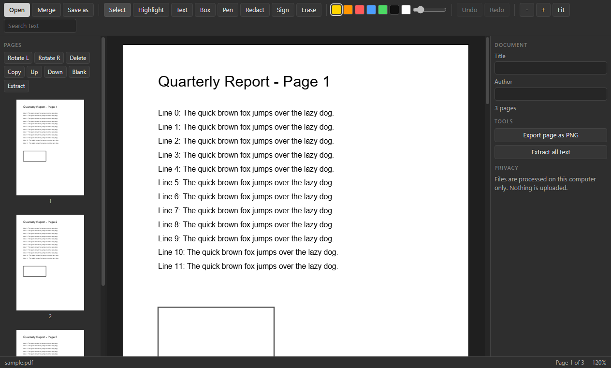

# Pageout

A fast, private PDF editor for Windows. Open, annotate, redact, reorder and export PDFs without an account, a subscription or an internet connection.

## What you can do

- **Read** PDFs with thumbnails, zoom, fit-to-width and text search
- **Annotate** with highlight, text, boxes, freehand pen and eraser
- **Sign** by drawing your signature and placing it on the page
- **Redact** sensitive content. Redaction is permanent: the covered area is burned into the page, not just hidden
- **Organize pages**: rotate, delete, copy, move, insert blank pages, extract
- **Merge** several PDFs into one
- **Edit document info** such as title and author
- **Export** a page as PNG or extract all text
- Undo and redo for every change

## Your files stay on your computer

Pageout has no account, no cloud and no tracking. Files are opened and saved only through the dialogs you use, and nothing is uploaded.

## Download

Get **Pageout-Setup-1.0.0.exe** from the [Releases](../../releases/latest) page and run it.

Part of the [Lookout](https://github.com/plawanpawin-byte/Lookout) family of apps.

Released under the MIT License.
