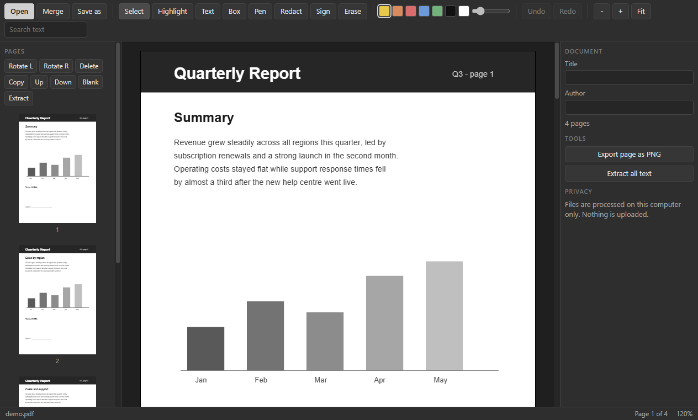
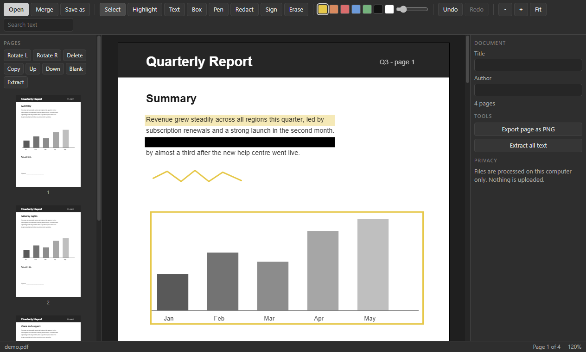
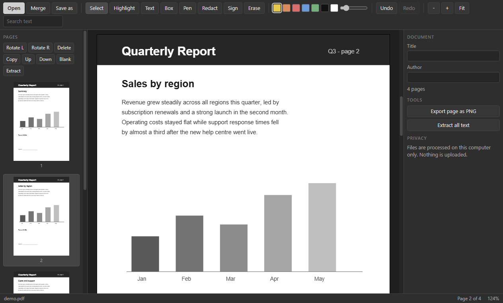

<b>Read, annotate and sign PDFs</b> Version 1.0.1 for Windows · Free · Offline · No account

<a href="https://github.com/plawanpawin-byte/pageout/releases/latest"><b>Download Pageout</b></a> · <a href="https://github.com/plawanpawin-byte/Lookout">All Lookout apps</a>

---

Pageout is a PDF reader and editor for Windows that works entirely on your computer. Open a document, highlight what matters, write notes, draw, sign, black out private details, rearrange pages and save a new copy. There is no account to create, no subscription and nothing is uploaded.

**Made for:** People who handle PDFs every day: contracts to sign, reports to mark up, scans to tidy, documents to share without leaking private details.

## See it in action

### Reading a PDF

Pages open in a continuous view with a thumbnail strip on the left and document details on the right. Zoom in and out, fit the page to the window, or search for words across the whole document.

### Marking up a page

A highlighter over a key sentence, a black redaction bar over a private line, a pen scribble and a box around the chart. Every mark can be moved, erased or undone.

### Organising pages

Select pages in the thumbnail strip, then rotate, copy, move, delete, insert a blank page or extract them into a new file.

### Fit to width

One click scales the page to the window so long documents are comfortable to read.

### What you get out

The current page exported as a sharp PNG image, ready to drop into a slide, a message or another document.

## Everything it can do

### Read

- Continuous page view with a thumbnail strip
- Zoom, fit to width and quick jumps between pages
- Search text across the whole document with every match highlighted
- Document panel showing the page count, title and author

### Annotate

- Highlighter, free text, rectangle box and freehand pen
- Seven ink colours and an adjustable line thickness
- Eraser to remove a single mark
- Select, move and resize marks after placing them
- Undo and redo for every change

### Sign

- Draw your signature with a mouse, pen or touch screen and place it anywhere on a page
- Resize the signature to fit the line

### Redact for real

- Draw a redaction box over any text or picture you must hide
- Redaction is permanent: when you save, the covered area is flattened into the page, so the hidden words cannot be copied or recovered

### Organise

- Rotate left or right, delete, copy, move up or down
- Insert blank pages
- Extract the selected pages into a new PDF
- Merge other PDFs into the document you have open

### Export

- Save a new PDF that includes your marks and changes
- Edit the title and author stored in the file
- Export any page as a PNG image
- Extract all text from the document

## How to use it

1. Click **Open** and choose a PDF. It opens at once.
2. Pick a tool in the top bar: **Highlight**, **Text**, **Box**, **Pen**, **Redact**, **Sign** or **Erase**. Choose a colour first if you like.
3. Click or drag on the page to place your mark. Switch back to **Select** to move or resize it.
4. Use the buttons on the left to rotate, delete or reorder pages.
5. Click **Save as** to write a new PDF. Your original file is left untouched.

## Keyboard shortcuts

| Keys | What it does |
| --- | --- |
| Ctrl + O | Open a PDF |
| Ctrl + S | Save |
| Ctrl + Z / Ctrl + Y | Undo / redo |
| Ctrl + mouse wheel | Zoom the page |
| Ctrl + plus / minus | Zoom in / out |
| Delete | Remove the selected mark |

## Files and formats

Opens PDF files. Saves PDF. Exports a page as PNG and the document text as plain text.

## Private by design

- No account, no sign-in, no subscription, no ads.
- Pageout works offline. It never sends your files, your text or anything about how you use it anywhere.
- Files are opened and saved only through the Windows file dialogs you use. Pageout cannot browse your disk on its own.
- The app window runs in a locked-down sandbox with a strict content policy.

## Install

1. Open the [latest release](https://github.com/plawanpawin-byte/pageout/releases/latest) and download the file named **Pageout-Setup-** followed by the version number and **.exe**. You can also install it from the [Lookout launcher](https://github.com/${OWNER}/lookout-launcher), which keeps it up to date.
2. Run the installer. It installs just for you, so it does not ask for administrator rights.
3. Windows may show a blue **Windows protected your PC** screen because these installers are not signed with a paid certificate. Click **More info**, then **Run anyway**.
4. Open Pageout from the Start menu.

**Requirements:** Windows 10 or 11, 64-bit. About 500 MB of free disk space. No internet connection is needed to use the app.

## Questions

**Does redaction really remove the text?**  
Yes. When you save, redacted areas become solid pixels in the new file, so the text underneath no longer exists there.

**Will it change my original PDF?**  
No. You save to a new file; the original is never overwritten unless you choose the same name yourself.

**Can it open password-protected PDFs?**  
Not at the moment. Remove the password first with the tool that created the file.

## About Lookout

Pageout belongs to the **[Lookout](https://github.com/plawanpawin-byte/Lookout)** family: ten small, private Windows apps for documents and media, all with the same calm grey look and the same promise that your files stay yours. Install and update them together with the [Lookout launcher](https://github.com/plawanpawin-byte/lookout-launcher).

Released under the MIT License.
