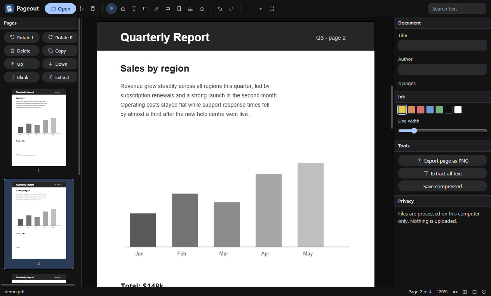
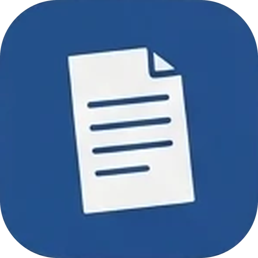

<h1 align="center">Pageout</h1>

<b>Read, annotate and sign PDFs</b> Version 1.0.14 for Windows · Free · Offline · No account

<a href="https://github.com/plawanpawin-byte/pageout/releases/latest"><b>Download Pageout</b></a> · <a href="https://github.com/plawanpawin-byte/lookout-launcher">Lookout launcher</a> · <a href="https://github.com/plawanpawin-byte/Lookout">All Lookout apps</a>

---

Pageout is a PDF reader and editor for Windows that works entirely on your computer. Open a document, highlight what matters, write notes, draw, sign, black out private details, rearrange pages and save a new copy. There is no account to create, no subscription and nothing is uploaded.

**Made for:** People who handle PDFs every day: contracts to sign, reports to mark up, scans to tidy, documents to share without leaking private details.

**On this page:** [In plain words](#in-plain-words) · [Who it is for](#who-it-is-for) · [Try it in 3 steps](#try-it-in-3-steps) · [Screenshots](#see-it-in-action) · [Features](#everything-it-can-do) · [How to use it](#how-to-use-it) · [Privacy](#private-by-design) · [Install](#install) · [Questions](#questions)

## In plain words

Pageout is a program for working with **PDF files** (the kind of document you get from a bank, a school, a government office or a contract). It does what you would do with a pen and a printer, but on screen: you read the document, highlight sentences, write notes in the margin, draw or sign with the mouse, and then save the result as a **new PDF** that you can email.

It can also tidy a document. You can rotate a sideways page, delete a page you do not need, move pages up or down, add a blank page, or pull a few pages out into their own file. It can **black out** private details such as an ID number so that the text is really removed from the file, not just covered.

**Not for:** Pageout does not edit the original wording of a PDF (it is not a word processor), and it does not read scanned pages out loud or turn pictures of text into text.

## Who it is for

- **Students and teachers** who highlight and take notes on papers and worksheets.
- **Anyone who signs documents**: draw your signature once, place it on a form, save the signed copy.
- **Office workers** who need to remove a page, rotate a scan or hide a phone number before sending a PDF to someone.

## Try it in 3 steps

1. Click **Open**, choose any PDF, and scroll through it. Use the page list on the left to jump around.
2. Pick the highlighter in the top bar, drag over a sentence, then press **Save** to keep a copy with the highlight in it.
3. Choose **Export page as PNG** in the right panel to turn the current page into a picture.

## What is new in 1.0.14

A new look inspired by Google's own tools (AI Studio, Colab, Gemini): a calm dark charcoal theme, rounded pill buttons, a soft blue accent and roomier spacing. The app icon is now a colour logo so you can find Pageout at a glance in the Start menu and in the Lookout launcher. All screenshots below were taken again with the new look.

## In plain words

Pageout is a program for working with **PDF files** (the kind of document you get from a bank, a school, a government office or a contract). It does what you would do with a pen and a printer, but on screen: you read the document, highlight sentences, write notes in the margin, draw or sign with the mouse, and then save the result as a **new PDF** that you can email.

It can also tidy a document. You can rotate a sideways page, delete a page you do not need, move pages up or down, add a blank page, or pull a few pages out into their own file. It can **black out** private details such as an ID number so that the text is really removed from the file, not just covered.

**Not for:** Pageout does not edit the original wording of a PDF (it is not a word processor), and it does not read scanned pages out loud or turn pictures of text into text.

## Who it is for

- **Students and teachers** who highlight and take notes on papers and worksheets.
- **Anyone who signs documents**: draw your signature once, place it on a form, save the signed copy.
- **Office workers** who need to remove a page, rotate a scan or hide a phone number before sending a PDF to someone.

## Try it in 3 steps

1. Click **Open**, choose any PDF, and scroll through it. Use the page list on the left to jump around.
2. Pick the highlighter in the top bar, drag over a sentence, then press **Save** to keep a copy with the highlight in it.
3. Choose **Export page as PNG** in the right panel to turn the current page into a picture.

## See it in action

### Reading a PDF

Pages open in a continuous view with a thumbnail strip on the left and document details on the right. Zoom in and out, fit the page to the window, or search for words across the whole document.

### Marking up a page

A highlighter over a key sentence, a black redaction bar over a private line, a pen scribble and a box around the chart. Every mark can be moved, erased or undone.

### Organising pages

Select pages in the thumbnail strip, then rotate, copy, move, delete, insert a blank page or extract them into a new file.

### Fit to width

One click scales the page to the window so long documents are comfortable to read.

### What you get out

The current page exported as a sharp PNG image, ready to drop into a slide, a message or another document.

## The interface

- **Top bar:** open, merge and save files, the markup tools (Select, Highlight, Text, Box, Pen, Redact, Sign, Erase), undo and redo, zoom, and text search.
- **Left panel:** page buttons (rotate, delete, copy, move, blank, extract) above live thumbnails of every page.
- **Right panel:** document title and author, ink colour and line width, export tools, and search results.

## Everything it can do

### Read

- Continuous page view with a thumbnail strip
- Zoom, fit to width and quick jumps between pages
- Search text across the whole document with every match highlighted
- Document panel showing the page count, title and author

### Annotate

- Highlighter, free text, rectangle box and freehand pen
- Seven ink colours and an adjustable line thickness
- Eraser to remove a single mark
- Select, move and resize marks after placing them
- Undo and redo for every change

### Sign

- Draw your signature with a mouse, pen or touch screen and place it anywhere on a page
- Resize the signature to fit the line

### Redact for real

- Draw a redaction box over any text or picture you must hide
- Redaction is permanent: when you save, the covered area is flattened into the page, so the hidden words cannot be copied or recovered

### Organise

- Rotate left or right, delete, copy, move up or down
- Insert blank pages
- Extract the selected pages into a new PDF
- Merge other PDFs into the document you have open

### Export

- Save a new PDF that includes your marks and changes
- Edit the title and author stored in the file
- Export any page as a PNG image
- Extract all text from the document

## How to use it

1. Click **Open** and choose a PDF. It opens at once.
2. Pick a tool in the top bar: **Highlight**, **Text**, **Box**, **Pen**, **Redact**, **Sign** or **Erase**. Choose a colour first if you like.
3. Click or drag on the page to place your mark. Switch back to **Select** to move or resize it.
4. Use the buttons on the left to rotate, delete or reorder pages.
5. Click **Save as** to write a new PDF. Your original file is left untouched.

## Keyboard shortcuts

| Keys | What it does |
| --- | --- |
| Ctrl + O | Open a PDF |
| Ctrl + S | Save |
| Ctrl + Z / Ctrl + Y | Undo / redo |
| Ctrl + mouse wheel | Zoom the page |
| Ctrl + plus / minus | Zoom in / out |
| Delete | Remove the selected mark |

## Files and formats

Opens PDF files. Saves PDF. Exports a page as PNG and the document text as plain text.

## Private by design

- No account, no sign-in, no subscription, no ads.
- Pageout works offline. It never sends your files, your text or anything about how you use it anywhere.
- Files are opened and saved only through the Windows file dialogs you use. Pageout cannot browse your disk on its own.
- The app window runs in a locked-down sandbox with a strict content policy.

## Install

1. Open the [latest release](https://github.com/plawanpawin-byte/pageout/releases/latest) and download the file named **Pageout-Setup-** followed by the version number and **.exe**. You can also install it from the [Lookout launcher](https://github.com/plawanpawin-byte/lookout-launcher), which keeps it up to date.
2. Run the installer. It installs just for you, so it does not ask for administrator rights.
3. Windows may show a blue **Windows protected your PC** screen because these installers are not signed with a paid certificate. Click **More info**, then **Run anyway**.
4. Open Pageout from the Start menu.

**Requirements:** Windows 10 or 11, 64-bit. About 500 MB of free disk space. No internet connection is needed to use the app.

## Questions

**Does redaction really remove the text?**  
Yes. When you save, redacted areas become solid pixels in the new file, so the text underneath no longer exists there.

**Will it change my original PDF?**  
No. You save to a new file; the original is never overwritten unless you choose the same name yourself.

**Can it open password-protected PDFs?**  
Not at the moment. Remove the password first with the tool that created the file.

**Does Pageout change my original PDF?**  
No. When you save, Pageout writes a new file. Your original stays as it was unless you choose to overwrite it yourself.

**Is my signature stored somewhere?**  
Only inside the files you sign and on your own computer. Nothing is sent anywhere.

**What does "redact for real" mean?**  
Many programs only draw a black box over text, and the text can still be copied from underneath. Pageout removes the text and image underneath, so it cannot be recovered.

**Does Pageout change my original PDF?**  
No. When you save, Pageout writes a new file. Your original stays as it was unless you choose to overwrite it yourself.

**Is my signature stored somewhere?**  
Only inside the files you sign and on your own computer. Nothing is sent anywhere.

**What does "redact for real" mean?**  
Many programs only draw a black box over text, and the text can still be copied from underneath. Pageout removes the text and image underneath, so it cannot be recovered.

## About Lookout

Pageout is part of **[Lookout](https://github.com/plawanpawin-byte/Lookout)**: ten small, private Windows apps for documents and media that share one look and one promise, that your files stay on your computer. Install and update them together with the [Lookout launcher](https://github.com/plawanpawin-byte/lookout-launcher).

| | App | What it is for | Code |
| --- | --- | --- | --- |
|  | **Lookout** | Install, open and update all the apps below | [GitHub](https://github.com/plawanpawin-byte/lookout-launcher) |
|  | **Pageout** | Read, annotate and sign PDFs | [GitHub](https://github.com/plawanpawin-byte/pageout) |
|  | **Chartout** | Flowcharts, org charts and diagrams | [GitHub](https://github.com/plawanpawin-byte/chartout) |
|  | **Branchout** | Mind maps and outlines | [GitHub](https://github.com/plawanpawin-byte/branchout) |
|  | **Planout** | Project plans and Gantt timelines | [GitHub](https://github.com/plawanpawin-byte/planout) |
|  | **Frameout** | App and web screen design with click-through prototypes | [GitHub](https://github.com/plawanpawin-byte/frameout) |
|  | **Cutout** | Video editing on a timeline | [GitHub](https://github.com/plawanpawin-byte/cutout) |
|  | **Shiftout** | Convert and compress video and audio, make GIFs | [GitHub](https://github.com/plawanpawin-byte/shiftout) |
|  | **Castout** | Record your screen | [GitHub](https://github.com/plawanpawin-byte/castout) |
|  | **Mendout** | Check and repair damaged video, audio, pictures and PDFs | [GitHub](https://github.com/plawanpawin-byte/mendout) |
|  | **Tuneout** | Record and edit audio | [GitHub](https://github.com/plawanpawin-byte/tuneout) |

Released under the MIT License.
